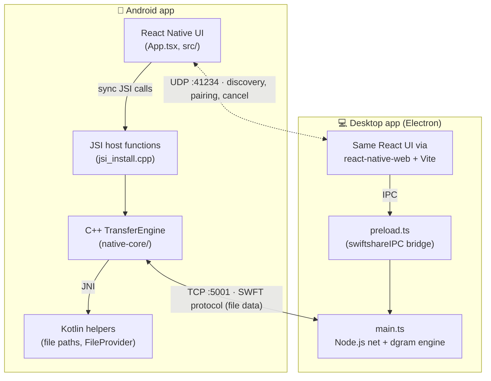
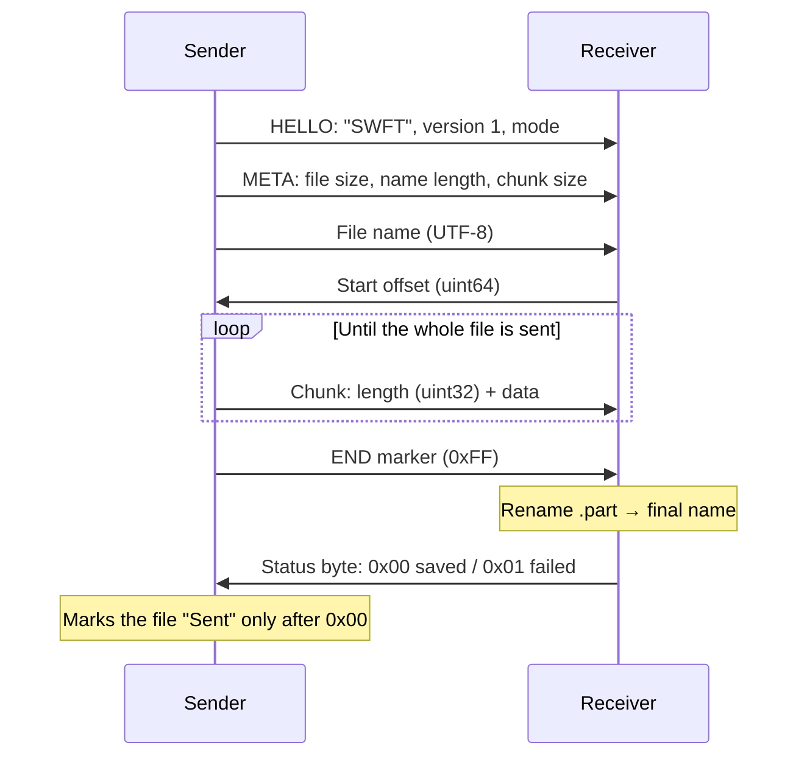

# SwiftShareX 🚀

**Fast, offline file sharing between Android, macOS and Windows.**

SwiftShareX sends files of any size directly between devices on the same Wi-Fi network or hotspot. There's no cloud, no account and no internet needed. The Android app is React Native on top of a custom **C++ TCP engine**; the desktop app is Electron running the same UI with a Node.js engine that speaks the same protocol.

---

## 📥 Downloads

- **🌐 [Official Website](https://mani5h-agarwal.github.io/SwiftShareX/)** (recommended)
- **📦 [GitHub Releases](https://github.com/mani5h-agarwal/SwiftShareX/releases/latest)**: macOS (`.dmg`) and Windows (`.exe`)
- **🤖 Google Play**: Android

---

## 📱 Screenshots

<div align="center">

<!-- Add your screenshots below -->
<table>
	<tr>
		<td></td>
		<td></td>
		<td></td>
	</tr>
	<tr>
		<td></td>
		<td></td>
		<td></td>
	</tr>
	<tr>
		<td></td>
		<td></td>
		<td></td>
	</tr>
</table>

</div>

---

## ✨ Features

- **🚀 Fast transfers**: native C++ sockets with large buffers, up to **80 MB/s** on 5 GHz Wi-Fi.
- **📂 No size limit**: multi-GB files are streamed straight from disk, never loaded into memory.
- **🗂️ Multi-file send**: pick several files, review the list, remove any you don't want, then send them as a queue.
- **✋ Fine-grained cancel**: cancel the current file, cancel one queued file, or cancel everything. Either side can stop a transfer.
- **✅ Confirmed delivery**: a file is only marked "Sent" after the receiver confirms it was saved to disk.
- **🧹 No broken files**: data is written to a `.part` file and only renamed once complete, so a dropped connection never leaves a half-written file behind.
- **📖 Tap to open**: open received files straight from the Receive tab.
- **🔍 Automatic discovery**: nearby devices appear on their own over UDP broadcast.
- **🔌 100% offline**: works on any local network or mobile hotspot, no mobile data used.
- **🔒 Private**: no accounts, no analytics, no servers. Files only travel between the two paired devices.

---

## 🛠️ How to Use

1. Put both devices on the same Wi-Fi network, or connect one to the other's hotspot.
2. Open SwiftShareX on both and choose **Send** on one and **Receive** on the other.
3. Tap the other device when it appears to pair with it.
4. Pick your files, check the list, and tap **Send**.

Received files are saved to **`Download/SwiftShareX`** on Android and **`~/Downloads/SwiftShareX`** on desktop.

---

## 🏗️ Architecture



### One UI, two engines

The React code in `App.tsx` and `src/` is shared by both apps. On desktop, Vite aliases React Native to `react-native-web`, and native-only libraries (file system, UDP, document picker, device info) are swapped for small Electron-backed versions in `desktop/src/mocks/`.

Both engines expose the same functions to the UI: `startReceiver`, `startSender`, `getProgress`, `takeTransferEvents`, `cancelSend` and `cancelTransfer`.

| | Android | Desktop |
|---|---|---|
| UI | React Native 0.88 (New Architecture, Hermes) | React 19 + react-native-web, Electron 41 |
| Transfer engine | C++20 `TransferEngine`, POSIX sockets, one thread per transfer | Node.js `net` in the Electron main process |
| Bridge to UI | JSI host functions installed on the JS runtime | `contextBridge` IPC (`preload.ts`) |
| Discovery | `react-native-udp` | Node.js `dgram` |
| Reading files | Reads straight from the picked file's descriptor, so large files aren't copied first (files it can't open directly, like some cloud files, are copied to cache) | Streams from the file path with backpressure |

### Engine design

- **Streaming in 256 KB chunks** with 8 MB socket buffers and `TCP_NODELAY`. Memory use stays flat no matter how big the file is.
- **Polling instead of callbacks**: the UI polls progress, and finished transfers are put on an event queue that the UI drains with `takeTransferEvents()`, so a small file that finishes between two polls is never missed.
- **Two kinds of cancel**: `cancelSend()` stops only the outgoing file and keeps the session alive for the rest of the queue; `cancelTransfer()` ends everything.
- **Defensive receiver**: it only accepts TCP connections from the paired device's IP, rejects chunk sizes over 4 MB, strips folder paths and control characters from incoming file names, and adds a number to the name instead of overwriting an existing file.

---

## 📡 Protocol

### Discovery and pairing (UDP, port 41234)

Plain-text messages, broadcast or sent directly between the two devices:

| Message | Purpose |
|---|---|
| `SWIFTSHAREX_DISCOVER\|role` | Broadcast every 1.5 s while looking for devices |
| `SWIFTSHAREX_HELLO\|id\|name\|role` | "I'm here", in reply to a discover |
| `SWIFTSHAREX_LOCK\|session\|id\|name\|role` | Pair with this device and start a session |
| `SWIFTSHAREX_SKIP\|session\|id\|size` | Receiver asks the sender to stop only the current file |
| `SWIFTSHAREX_CANCEL\|session\|id` | Abort all transfers in the session |
| `SWIFTSHAREX_BYE\|session\|id` | End the session |

### File transfer: SWFT (TCP, port 5001, little-endian)

Each file uses its own TCP connection:



If the sender stops a file partway, it sends the END marker early. The receiver sees fewer bytes than promised, deletes the `.part` file and reports the file as cancelled rather than failed.

---

## 🧩 Project Structure

```
SwiftShareX/
├── App.tsx                     # App state: discovery, pairing, send queue, events
├── src/
│   ├── screens/                # ChooseRole, DevicePicker, Session
│   ├── components/             # File cards, device cards, tab bar, buttons
│   ├── modals/                 # Send confirmation (file list with remove)
│   ├── navigation/             # Root navigator
│   └── types/, utils/, hooks/
├── android/app/src/main/
│   ├── cpp/
│   │   ├── native-core/        # C++ TransferEngine + SWFT protocol header
│   │   └── jsi_install.cpp     # Exposes the engine to JavaScript
│   └── java/com/swiftshare/    # Kotlin: JSI module, file paths, open file
├── desktop/
│   ├── electron/main.ts        # Node.js engine, UDP, file system, IPC
│   ├── electron/preload.ts     # swiftshareIPC bridge
│   ├── src/mocks/              # Desktop versions of native-only libraries
│   └── vite.config.ts          # react-native → react-native-web aliasing
├── docs/                       # Landing page (GitHub Pages)
├── __tests__/                  # Jest tests
└── .github/workflows/          # Desktop release pipeline
```

---

## 💻 Development

**Requirements:** Node.js 22.11+, JDK 17, and the Android SDK (compile SDK 37) with NDK 27.1.

```bash
# Android: plug in a phone with USB debugging, then
npm install
npm run android

# Desktop: runs Vite and opens Electron with hot reload
cd desktop
npm install
npm run dev

# Tests and lint
npm test
npm run lint
```

### Release builds

- **Android:** `cd android && ./gradlew bundleRelease` (Play Store `.aab`) or `assembleRelease` (`.apk`). Signing reads `MYAPP_UPLOAD_STORE_FILE`, `MYAPP_UPLOAD_KEY_ALIAS` and the passwords from `~/.gradle/gradle.properties`. Never commit the keystore or passwords.
- **Desktop:** `cd desktop && npm run build:app`. Merging to `main` (or pushing a `v*` tag) makes GitHub Actions build the macOS and Windows apps and upload them to a **draft** release for `desktop/package.json`'s version. Bump that version first, then publish the draft on GitHub.

---

## 📱 System Requirements

- **Android:** 7.0 (API 24) or higher
- **macOS:** 12 (Monterey) or higher, Apple Silicon
- **Windows:** 10 or higher, 64-bit
- Both devices on the same local network or hotspot

---

## 🍏 macOS: First Launch

> [!IMPORTANT]
> SwiftShareX isn't notarized by Apple yet, so macOS blocks it the first time you open it.

1. Open the **.dmg** and drag SwiftShareX to **Applications**.
2. Open it. When macOS shows a warning, click **Done**.
3. Go to **System Settings → Privacy & Security**.
4. Scroll to **Security** and click **Open Anyway** next to SwiftShareX.
5. Confirm with **Open**.

---

## 👥 Privacy

SwiftShareX doesn't track you, collect data, or need an account. Files go directly from one device to the other over your local network and never touch a server.

> [!NOTE]
> Transfers are not encrypted yet. Only use SwiftShareX on networks you trust.

---

## 📄 License

[MIT](LICENSE) © 2025 Manish Agarwal
